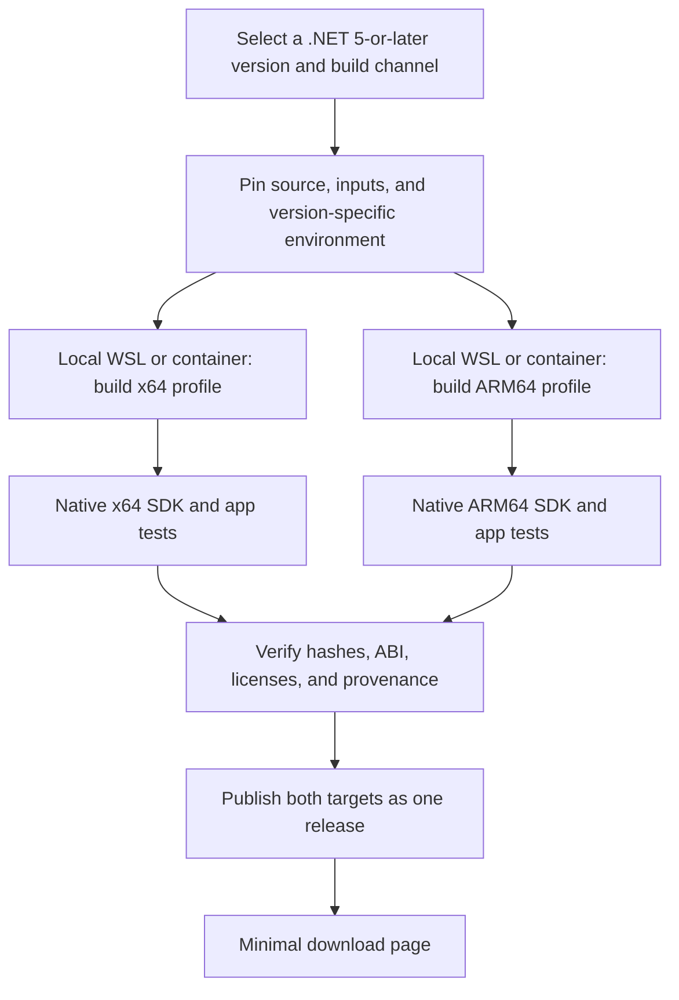

# Automated builds and minimal binary distribution

Review date: 2026-10-28. This document proposes the subsequent implementation; it does not describe an operational CI service or public download URLs.

**CI implementation follow-up:** all eight selected native ARM64 profiles have passed hosted builds and downloaded source-inclusive delivery qualification. The [version-specific CI guide](ci-matrix.md) and [qualification records](ci-matrix-results.md) identify their actual runs and measured hosted resources. The design and dated local milestones below retain their historical scope. Public download-site operation and native x64 remain separate work.

**Project direction update, 2026-10-30:** the goal is ongoing community Linux SDK builds for every .NET major version from .NET 5 onward, regardless of Microsoft's support lifecycle. Establish version-specific environments in local WSL and containers before CI migration. Prefer VMR where applicable and use the appropriate legacy construction path for older versions. The [.NET 9.0.123 ARM64 local build](build-report-9.0.123-arm64.md) has now completed with SDK execution and ABI validation in three Linux user spaces. The original review date and source references remain the historical basis of this design.

For the later review of concrete runner choices and changes to the implemented build, see the [GitHub Actions migration assessment](github-actions-migration.md). The [version coverage assessment](dotnet-version-coverage.md) separates legacy, source-build, regular VMR, and development release paths.

The subsequent [.NET 8.0.133 ARM64 build](build-report-8.0.133-arm64.md) also completed locally with both shared frameworks built from the VMR. Its collected SDK passed native execution and ABI checks in the same three Linux user spaces. This adds a legacy VMR source-build environment; CI migration and public binary publishing remain separate work.

The [.NET 7.0.120 ARM64 build](build-report-7.0.120-arm64.md) subsequently completed through the older installer source-build generator. Its locally built core and ASP.NET runtimes and collected SDK passed byte-identity, native application and ABI checks in three Linux user spaces. Its separate WSL environment, LLVM 16 toolchain, bootstrap transformation and four compatibility patches demonstrate why legacy versions need their own profiles.

**Local build update, 2026-10-31:** [.NET 6.0.136](build-report-6.0.136-arm64.md), [.NET 5.0.214](build-report-5.0.214-arm64.md), [Core 3.1.426](build-report-3.1.426-arm64.md) and [Core 3.0.103](build-report-3.0.103-arm64.md) now have native ARM64 SDK artifacts. Core 3.0 construction, origin and native checks are established; upstream suite status is recorded separately in its report. CI and native x64 remain unmeasured. The older .NET 5/Core 3 validation retains explicit external OpenSSL 1.1 inputs, and Core 3 on Debian 13 additionally uses ICU 66. Download descriptions must preserve these dependency limits and the [coverage assessment](dotnet-version-coverage.md)'s actual acceptance scope.

## 1. Build flow



Build and validate each major version's environment locally in WSL or containers first. The existing ARM64 environment is a reference, not evidence that all older versions or x64 work with the same commands. Record version-specific source repositories, bootstrap inputs, toolchains, and ABI policies. Once the local environment work has been established and reviewed, the accepted profiles can move to CI; dedicated runners are a later option for availability, power, and update management. Both target architectures must use coherent source and version policies with their own validated inputs.

For later CI planning, the documentation inspected during the review lists 14 GB of SSD storage for standard GitHub-hosted Linux runners. General source-build guidance calls for approximately 30 GB with cleanup or 80 GB without it, so large VMR builds need runners with additional storage or self-hosted runners. Standard hosted runners may handle orchestration, documentation and artifact checks, and smoke tests that fit their resources. Choose worker sizes and budgets from the local version-specific measurements before a CI pilot. [GitHub runner specifications](https://docs.github.com/en/actions/reference/runners/github-hosted-runners), [VMR resource requirements](https://github.com/dotnet/source-build/blob/main/Documentation/system-requirements.md).

## 2. Update and release policy

- Initially, build each version manually in its established local environment with a fixed input manifest. After local acceptance and CI migration, a scheduled job can detect available upstream releases or tags across the .NET 5-and-later scope and create build candidates.
- Treat rebuilds of published releases, project-maintained rebuilds, prereleases, and development snapshots as distinct channels. Pin the selected repository and revision, including legacy repositories where VMR does not apply.
- Resolve the tag to a SHA and pin the source, bootstrap inputs, PSB artifacts, image, and build script revision before passing them to both target jobs.
- If either target fails, retain the existing public release. Update both download rows together after both targets pass validation.
- Publish artifacts by their verified digests. Do not rebuild the SDK during publishing.
- Keep release files immutable. Rebuilding the same upstream version requires a new project build revision and a recorded reason for the change.
- Rebuild available upstream security updates promptly using a new manifest and full validation. For majors without ongoing upstream releases, retain their community build scope and track project rebuilds or changes explicitly. Continued binary availability does not imply new upstream security fixes.
- Record Microsoft lifecycle dates as upstream metadata, separately from community build availability and tested compatibility. End of Microsoft support is not a reason to remove a major version from the target matrix or automatically retire its community downloads.

When implementing automation, separate build, validation, and publishing permissions. Configure workflows and self-hosted workers so that code from external pull requests does not execute with public release credentials. This is a permissions design for future public CI; it does not change this PC's configuration.

## 3. Build profile fields

| Field | Information to record |
| --- | --- |
| source | Source repository URL (VMR or the version-specific legacy repository), tag, full commit SHA, source archive hash, and applied patches |
| product | Actual SDK version, included runtime and ASP.NET Core versions, and feature band |
| build | Project build revision, wrapper script SHA, complete command, and source-only setting |
| host | OS, CPU, container execution platform, and image digest |
| target | RID, CPU, sysroot identity and hash, libc, and ABI boundaries |
| toolchain | clang/LLVM, CMake, linker, and package versions |
| bootstrap | CPU, version, and hashes for host SDK/PSB inputs and target shared components separately |
| validation | Stage 1/2 where applicable to the build mode, functional tests by target CPU and OS, skipped checks, and exceptions |
| artifacts | Paths, sizes, SHA-256, symbols, licenses, SBOM, and provenance |
| operation | Build duration, peak memory and disk usage, and log locations |
| lifecycle | Microsoft support dates and phase as metadata, separate from community build availability and validation scope |

These fields translate OpenJDK's Boot JDK, devkit, and target configuration into declarative .NET build profiles. Arbitrarily changing internal SDK or NuGet versions to project-specific versions can affect package resolution. Initially, preserve upstream versioning and show the project build revision in external filenames, manifests, and the download page. [OpenJDK profiles](https://github.com/openjdk/jdk/blob/jdk-27-ga/make/conf/jib-profiles.js), [VMR versioning design](https://github.com/dotnet/dotnet/blob/v10.0.114/docs/VMR-Product-Versioning.md).

## 4. Distribution artifacts

| Category | Initial policy |
| --- | --- |
| SDK archives | ARM64 and x64 `.tar.gz` files per validated version/release, preserving the contents generated by its selected SDK build system; advertise only artifacts actually built and checked |
| Integrity | Per-file SHA-256 and a complete checksum list |
| Release information | Changes, upstream baseline, known limitations, and installation and verification instructions |
| Source and rebuilding | VMR SHA link, project scripts, and source/patch hashes |
| Detailed manifest | A machine-readable record linking both targets' actual inputs, outputs, and tests |
| Licenses | Review and preserve LICENSE files and component-specific third-party notices inside the SDK |
| Symbols | Identify matching symbol artifacts and retain and provide them separately |
| Internal retention | PSB archives, Stage 2 inputs, binlogs, ABI checks, and resource measurements |
| Supply chain information | Generate and verify an SBOM and build provenance, with publisher attestation where available |

An example filename is `cbodotnet-sdk-<sdk-version>-linux-arm64-build.<n>.tar.gz`. Keep the project build revision separate from the upstream product version. If an artifact is still distribution-specific, state its actual supported scope, such as `ubuntu.22.04-arm64`, in its filename and download page.

A successful `-sb` build does not automatically provide a complete SBOM or provenance record. Define the SBOM's scope and format and reconcile it with the files and components actually shipped. SHA-256 verifies file integrity; publisher identity requires a separate signature or attestation. If GitHub Actions is selected, consider its artifact provenance and SBOM attestation features. [GitHub attestation guidance](https://docs.github.com/en/actions/how-tos/secure-your-work/use-artifact-attestations/use-artifact-attestations).

The ability to rebuild from the same SHA and byte-for-byte reproducibility are separate goals. Verify pinned inputs and provenance for every published profile. Source-only profiles that require Stage 2 must record that validation; regular builds must accurately identify reused upstream components instead of claiming source-only construction. Do not claim bit-for-bit reproducibility before measuring it.

## 5. Minimal download page

The goal is a minimal distribution page inspired by the requested [JDK 27 page](https://jdk.java.net/27/). Its contents returned HTTP 403 during research, so this proposal does not claim to reproduce the current page's exact wording, file sizes, or structure.

```text
cbodotnet — .NET <major> SDK
Community builds from .NET source

SDK <version> · build <n> · <date>

Platform                 Download          Size       SHA-256
Linux (glibc) AArch64    tar.gz             <actual>   <checksum>
Linux (glibc) x64        tar.gz             <actual>   <checksum>

Versions · Requirements · Release notes · Source · Build information · Archive
```

Requirements should list the tested distributions, minimum ABI, and required system libraries. The current archives target generic glibc Linux, with separately recorded compatibility inputs for older runtimes; they are not musl/Alpine or fully static packages. An older SDK may print its detected distribution RID while executing a portable archive. Use the [portability review](linux-portability-review.md) to preserve those distinctions in download descriptions. Build information should link to the detailed manifest, test results, symbols, SBOM, and provenance. Static HTML and a release manifest are sufficient initially; authentication, package manager integration, and advanced search are unnecessary.

The version index should cover the .NET 5-and-later goal and distinguish available artifacts, work in progress, and unresearched build paths. Show Microsoft's lifecycle metadata without using it to hide older community builds. The two download rows above apply to a selected release and must link only to architectures that have completed validation.

Even when the page presents only two downloads, consumers must be able to identify the source and profile used for each binary. Calculate actual sizes and hashes from the artifacts being published.

## 6. Redistribution and project identity

The VMR provides an MIT license. Review and preserve the licenses and third-party notices for the components actually included in each archive. These are distribution preparation requirements identified from the current source; they do not replace legal review of the final artifacts. [VMR LICENSE](https://github.com/dotnet/dotnet/blob/v10.0.114/LICENSE.TXT), [THIRD-PARTY-NOTICES](https://github.com/dotnet/dotnet/blob/v10.0.114/THIRD-PARTY-NOTICES.txt).

Use the project's own name and clearly identify that it builds .NET source, who operates it, and its relationship to upstream. Do not imply that the binaries, signatures, or warranties come from Microsoft. OpenJDK's GPL/ClassPath exception does not become the distribution license for this .NET project. [Microsoft trademark guidelines](https://www.microsoft.com/en-us/legal/intellectualproperty/trademarks).

## 7. Implementation sequence

| Step | Work | Reviewable result |
| --- | --- | --- |
| 1 | Inventory source and construction paths for all majors from .NET 5 onward | Version matrix with accepted local profiles and explicit remaining version, band and architecture gaps |
| 2 | Establish local WSL/container environments per version | Accepted ARM64 profiles with pinned source, bootstrap, toolchain, sysroot and dependency inputs; native x64 remains separate work |
| 3 | Build and validate ARM64 and x64 profiles locally | SDK archives, applicable upstream and Stage 2 checks, ABI and application tests, and resource measurements |
| 4 | Freeze accepted wrappers and manifests, then migrate them to CI | Clean CI pilot compared with the accepted local profile and its recorded inputs |
| 5 | Implement release detection, failure handling, and publishing across accepted profiles | A workflow that promotes only the verified release scope without lifecycle-based exclusions |
| 6 | Build a static download page and version index | Actual downloads, checksums, provenance links, and separate lifecycle/availability metadata |

The existing .NET 10 ARM64 archive is the first demonstrated profile, not the boundary of the project's version scope. The ongoing goal is community build coverage for every major version from .NET 5 onward. A version/architecture becomes available only after its local build and checks produce actual evidence; CI follows accepted local environments. Each public release must provide coherent release inputs, its verified architecture and compatibility scope, immutable artifacts, and provenance information.
