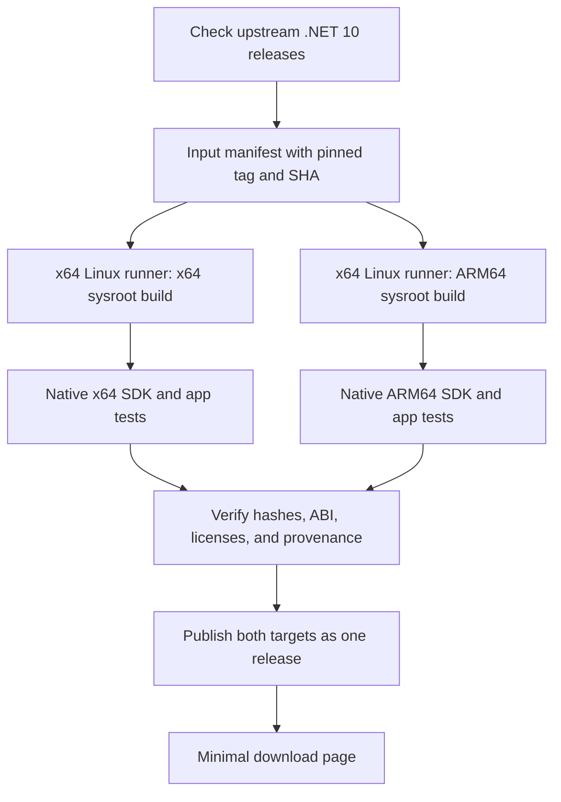

# Automated builds and minimal binary distribution

Review date: 2026-10-28. This document proposes the subsequent implementation; it does not describe an operational CI service or public download URLs.

## 1. Build flow



Use local WSL for ARM64 build experiments and ARM64 testing. For ongoing public builds, consider dedicated runners to account for availability, power, and updates. Building each target natively remains an alternative, provided both builds follow the same source, version, and ABI policies.

The current documentation lists 14 GB of SSD storage for standard GitHub-hosted Linux runners. General source-build guidance calls for approximately 30 GB with cleanup or 80 GB without it, so large VMR builds should use runners with additional storage or self-hosted runners. Start with standard hosted runners for orchestration, documentation and artifact checks, and smoke tests that fit their resources. Choose worker sizes and budgets after measuring the proof of concept. [GitHub runner specifications](https://docs.github.com/en/actions/reference/runners/github-hosted-runners), [VMR resource requirements](https://github.com/dotnet/source-build/blob/main/Documentation/system-requirements.md).

## 2. Update and release policy

- Initially, trigger builds manually with a fixed input manifest. Later, a scheduled job can detect new .NET 10 releases or tags and create build candidates.
- Treat daily builds of `main` and rebuilds of official .NET 10 releases as separate channels. Release rebuilds are the initial public offering.
- Resolve the tag to a SHA and pin the source, bootstrap inputs, PSB artifacts, image, and build script revision before passing them to both target jobs.
- If either target fails, retain the existing public release. Update both download rows together after both targets pass validation.
- Publish artifacts by their verified digests. Do not rebuild the SDK during publishing.
- Keep release files immutable. Rebuilding the same upstream version requires a new project build revision and a recorded reason for the change.
- Rebuild security updates promptly using a new manifest and full validation. Show the support status and archive location for older releases.

When implementing automation, separate build, validation, and publishing permissions. Configure workflows and self-hosted workers so that code from external pull requests does not execute with public release credentials. This is a permissions design for future public CI; it does not change this PC's configuration.

## 3. Build profile fields

| Field | Information to record |
| --- | --- |
| source | VMR URL, tag, full commit SHA, source archive hash, and applied patches |
| product | Actual SDK version, included runtime and ASP.NET Core versions, and feature band |
| build | Project build revision, wrapper script SHA, complete command, and source-only setting |
| host | OS, CPU, container execution platform, and image digest |
| target | RID, CPU, sysroot identity and hash, libc, and ABI boundaries |
| toolchain | clang/LLVM, CMake, linker, and package versions |
| bootstrap | CPU, version, and hashes for host SDK/PSB inputs and target shared components separately |
| validation | Stage 1/2, functional tests by target CPU and OS, skipped checks, and exceptions |
| artifacts | Paths, sizes, SHA-256, symbols, licenses, SBOM, and provenance |
| operation | Build duration, peak memory and disk usage, and log locations |

These fields translate OpenJDK's Boot JDK, devkit, and target configuration into declarative .NET build profiles. Arbitrarily changing internal SDK or NuGet versions to project-specific versions can affect package resolution. Initially, preserve upstream versioning and show the project build revision in external filenames, manifests, and the download page. [OpenJDK profiles](https://github.com/openjdk/jdk/blob/jdk-27-ga/make/conf/jib-profiles.js), [VMR versioning design](https://github.com/dotnet/dotnet/blob/v10.0.114/docs/VMR-Product-Versioning.md).

## 4. Distribution artifacts

| Category | Initial policy |
| --- | --- |
| SDK archives | Two architecture-specific `.tar.gz` files, preserving the contents generated by the upstream SDK build |
| Integrity | Per-file SHA-256 and a complete checksum list |
| Release information | Changes, upstream baseline, known limitations, and installation and verification instructions |
| Source and rebuilding | VMR SHA link, project scripts, and source/patch hashes |
| Detailed manifest | A machine-readable record linking both targets' actual inputs, outputs, and tests |
| Licenses | Review and preserve LICENSE files and component-specific third-party notices inside the SDK |
| Symbols | Identify matching symbol artifacts and retain and provide them separately |
| Internal retention | PSB archives, Stage 2 inputs, binlogs, ABI checks, and resource measurements |
| Supply chain information | Generate and verify an SBOM and build provenance, with publisher attestation where available |

An example filename is `cbodotnet-sdk-<sdk-version>-linux-arm64-build.<n>.tar.gz`. Keep the project build revision separate from the upstream product version. If an artifact is still distribution-specific, state its actual supported scope, such as `ubuntu.22.04-arm64`, in its filename and download page.

A successful `-sb` build does not automatically provide a complete SBOM or provenance record. Define the SBOM's scope and format and reconcile it with the files and components actually shipped. SHA-256 verifies file integrity; publisher identity requires a separate signature or attestation. If GitHub Actions is selected, consider its artifact provenance and SBOM attestation features. [GitHub attestation guidance](https://docs.github.com/en/actions/how-tos/secure-your-work/use-artifact-attestations/use-artifact-attestations).

The ability to rebuild from the same SHA and byte-for-byte reproducibility are separate goals. For the first public release, verify pinned inputs, Stage 2, and provenance records. Do not claim bit-for-bit reproducibility before measuring it.

## 5. Minimal download page

The goal is a minimal distribution page inspired by the requested [JDK 27 page](https://jdk.java.net/27/). Its contents returned HTTP 403 during research, so this proposal does not claim to reproduce the current page's exact wording, file sizes, or structure.

```text
cbodotnet — .NET 10 SDK
Community builds from dotnet/dotnet

SDK <version> · build <n> · <date>

Platform          Download          Size       SHA-256
Linux AArch64     tar.gz             <actual>   <checksum>
Linux x64         tar.gz             <actual>   <checksum>

Requirements · Release notes · Source · Build information · Archive
```

Requirements should list the tested distributions, minimum ABI, and required system libraries. Build information should link to the detailed manifest, test results, symbols, SBOM, and provenance. Static HTML and a release manifest are sufficient initially; authentication, package manager integration, and advanced search are unnecessary.

Even when the page presents only two downloads, consumers must be able to identify the source and profile used for each binary. Calculate actual sizes and hashes from the artifacts being published.

## 6. Redistribution and project identity

The VMR provides an MIT license. Review and preserve the licenses and third-party notices for the components actually included in each archive. These are distribution preparation requirements identified from the current source; they do not replace legal review of the final artifacts. [VMR LICENSE](https://github.com/dotnet/dotnet/blob/v10.0.114/LICENSE.TXT), [THIRD-PARTY-NOTICES](https://github.com/dotnet/dotnet/blob/v10.0.114/THIRD-PARTY-NOTICES.txt).

Use the project's own name and clearly identify that it builds .NET source, who operates it, and its relationship to upstream. Do not imply that the binaries, signatures, or warranties come from Microsoft. OpenJDK's GPL/ClassPath exception does not become the distribution license for this .NET project. [Microsoft trademark guidelines](https://www.microsoft.com/en-us/legal/intellectualproperty/trademarks).

## 7. Implementation sequence

| Step | Work | Reviewable result |
| --- | --- | --- |
| 1 | Prepare WSL storage and tools; run an ARM64 proof of concept | Build logs, SDK archive, functional tests, and resource measurements |
| 2 | Add an x64 Linux runner and two sysroot profiles | Pinned inputs and build outputs for both RIDs |
| 3 | Validate ABI, functionality, and Stage 2 | Supported OS and feature scope, with evidence of rebuilding |
| 4 | Automate the wrapper and manifest | Repeatable, manually triggered CI using the same inputs |
| 5 | Implement release detection, failure handling, and publishing | A workflow that promotes both targets together |
| 6 | Build a static download page | Working downloads, checksums, and evidence links |

The first implementation is complete when a local ARM64 archive and test results are available. Public distribution is complete when both targets share the same release inputs and provide a validated support scope, immutable artifacts, and provenance information.
